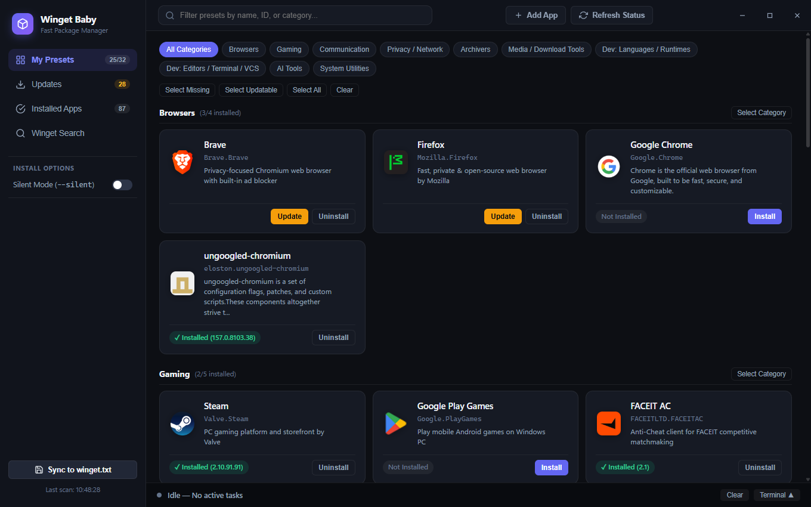
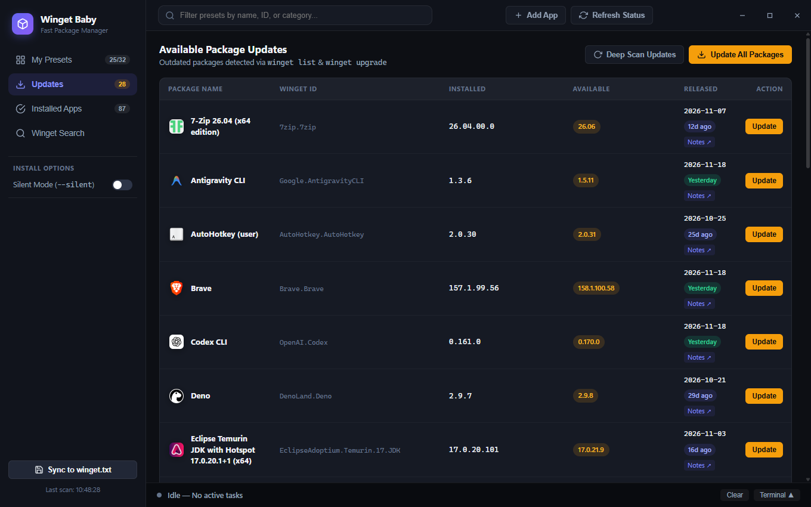
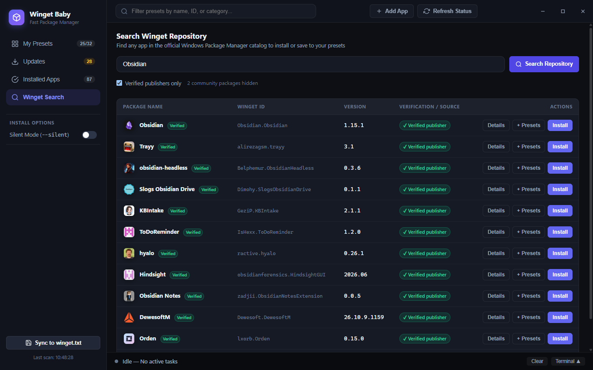
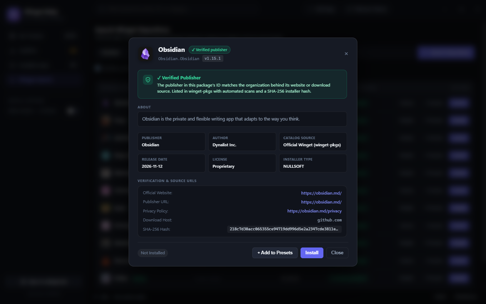
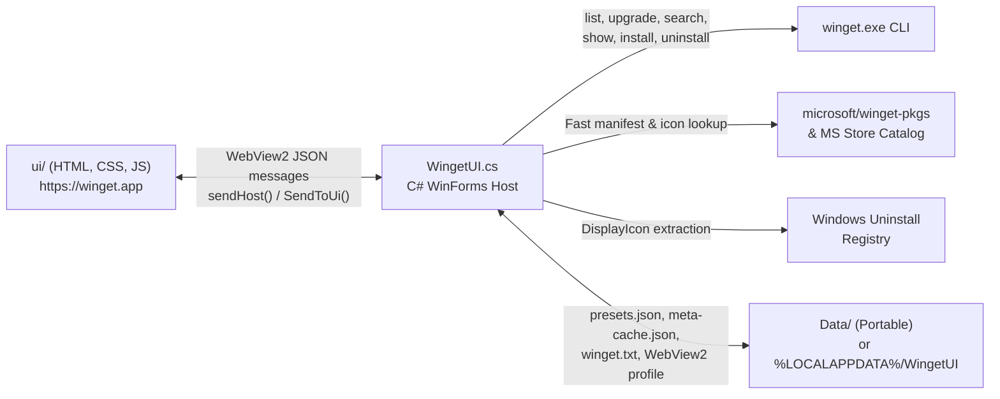

<div align="center">
  
  <h1>WingetUI</h1>
  <p>A fast, portable Windows desktop GUI for <code>winget</code> — manage curated app presets, batch installs, updates, and verified catalog searches.</p>
  <p>
    
    
    
    <a href="https://github.com/projectGloria/WingetUI/actions/workflows/build.yml"></a>
    <a href="https://github.com/projectGloria/WingetUI/commits/main"></a>
  </p>
</div>

<p align="center">
  
  <br /><em>My Presets: browse curated categories, see live install/update status, and batch-queue actions.</em>
</p>

<p align="center">
  <a href="#about">About</a> &middot;
  <a href="#features">Features</a> &middot;
  <a href="#screenshots">Screenshots</a> &middot;
  <a href="#how-it-works">How It Works</a> &middot;
  <a href="#installation">Installation</a> &middot;
  <a href="#usage">Usage</a> &middot;
  <a href="#building-from-source">Building from Source</a> &middot;
  <a href="#how-to-release">How to Release</a> &middot;
  <a href="#configuration">Configuration</a> &middot;
  <a href="#contributing">Contributing</a>
</p>

## About

**WingetUI** is a lightweight Windows desktop interface for the Windows Package Manager (`winget`). It pairs a single-file C# WinForms host ([WingetUI.cs](WingetUI.cs)) with an embedded Microsoft Edge WebView2 frontend ([ui/](ui/)) written in vanilla HTML, CSS, and JavaScript.

It compiles directly with Windows' built-in .NET Framework compiler (`csc.exe`) with no Visual Studio, Node.js, or bundler required, and packages into a self-contained portable folder you can move between machines.

## Features

- **Curated Presets & Batch Queueing**: Organize your standard apps into categories, filter by name, ID, or category, and use one-click chips (**Select Missing**, **Select Updatable**, **Select All**) to queue installs, updates, or uninstalls with optional `--silent` mode.
- **Update Tracking with Release Dates & Notes**: Combines `winget list` and `winget upgrade --include-unknown` with manifest lookups against `microsoft/winget-pkgs` to surface release dates and release-notes links alongside one-click **Update** and **Update All** actions.
- **Verified-Publisher Catalog Search**: Searches the official Winget repository (`winget search`), scores publisher authenticity against package domains and Microsoft Store certification, and filters out unverified community packages by default.
- **Package Inspection & Integrity Verification**: Open any package's details modal to inspect its publisher, author, catalog source, license, installer type, download host, official URLs, and installer SHA-256 hash before installing.
- **Live Terminal Drawer & Cancellable Tasks**: Runs mutating `winget` commands sequentially from a UI task queue, streams live output into a collapsible console drawer, and lets you cancel an active operation at any time.
- **Portable Data & Markdown Export**: Keeps presets, a 7-day metadata cache (`meta-cache.json`), and the WebView2 profile inside a local `Data\` folder next to `WingetUI.exe` (falling back to `%LOCALAPPDATA%\WingetUI` when read-only), and exports your preset list to `Data\winget.txt`.

## Screenshots

<p align="center">
  
  <br /><em>Updates: review outdated packages with release dates, release notes links, and one-click or bulk upgrades.</em>
</p>

<p align="center">
  
  <br /><em>Winget Search: query the official catalog with verified-publisher filtering and one-click preset saving.</em>
</p>

<p align="center">
  
  <br /><em>Package Details: verify publisher status, license, installer type, download host, and SHA-256 hash before installing.</em>
</p>

## How It Works



`WingetUI.cs` maps the local `ui/` directory to the virtual host `https://winget.app` inside WebView2 and exchanges JSON messages with `ui/app.js`. After listing installed packages via `winget`, the host asynchronously enriches icons and metadata in parallel—checking Windows Uninstall registry keys for local icons, pulling YAML manifests from `microsoft/winget-pkgs`, and falling back to `winget show` when needed—while caching results for 7 days in `Data\meta-cache.json`.

## Installation

### Requirements

- **OS**: Windows 10 (20H1+) or Windows 11 (x64)
- **Windows Package Manager**: `winget` installed and available on `PATH`
- **WebView2 Runtime**: Microsoft Edge WebView2 Runtime (pre-installed on Windows 11 and most Windows 10 machines)

### Quick Start

1. Clone the repository and build the portable package (see [Building from Source](#building-from-source)):

   ```powershell
   git clone https://github.com/projectGloria/WingetUI.git
   cd WingetUI
   .\build.ps1
   ```

2. Run `.\WingetUI.exe` directly, or copy `dist\WingetUI\` (or extract `dist\WingetUI-portable.zip`) to any folder and launch `WingetUI.exe`.

On first launch, WingetUI copies the seed [presets.json](presets.json) into `Data\presets.json` and scans your installed packages. All runtime state stays inside `Data\` next to the executable so the folder remains portable.

## Usage

- **Batch-install a new PC setup**: Open **My Presets**, click **Select Missing**, toggle **Silent Mode (`--silent`)** in the sidebar if you want unattended installs, and click **Install Selected**.
- **Keep software up to date**: Open **Updates** to inspect outdated packages, release dates, and release notes. Click **Deep Scan Updates** to run `winget upgrade --include-unknown`, or click **Update All Packages** to queue every available update.
- **Find and save new apps**: Open **Winget Search**, search the catalog (e.g. `Obsidian`, `VLC`, `Blender`), click **Details** to inspect the manifest and SHA-256 hash, then click **+ Presets** or **Install**.
- **Export your preset list**: Click **Sync to winget.txt** in the sidebar footer to write a Markdown list of your current presets to `Data\winget.txt`.
- **Developer Tools**: Launch with `--devtools` to enable F12 / WebView2 DevTools (disabled by default to prevent accidental reloads from clearing the active task queue):

  ```powershell
  .\WingetUI.exe --devtools
  ```

## Building from Source

### Prerequisites

- Windows x64 with PowerShell
- .NET Framework 4.x compiler at `C:\Windows\Microsoft.NET\Framework64\v4.0.30319\csc.exe` (included with Windows)
- Internet access on the first build (if `Microsoft.Web.WebView2.Core.dll`, `Microsoft.Web.WebView2.WinForms.dll`, and `WebView2Loader.dll` are not already present, [build.ps1](build.ps1) downloads the official `Microsoft.Web.WebView2` NuGet package and extracts them automatically)

### Build Steps

1. Clone the repository:

   ```powershell
   git clone https://github.com/projectGloria/WingetUI.git
   cd WingetUI
   ```

2. Run the build script (stops any running `WingetUI.exe` instance, compiles the executable, and assembles the portable bundle):

   ```powershell
   .\build.ps1
   ```

3. Launch the app:

   ```powershell
   .\WingetUI.exe
   ```

### Build Outputs

| Artifact | Path | Description |
| --- | --- | --- |
| Executable | `WingetUI.exe` | Compiled x64 WinForms + WebView2 host |
| Portable folder | `dist\WingetUI\` | Self-contained folder with `WingetUI.exe`, WebView2 DLLs, `ui/`, and seed `presets.json` |
| Portable archive | `dist\WingetUI-portable.zip` | Zipped copy of `dist\WingetUI\` |

> [!NOTE]
> Frontend edits under `ui/` do not require recompiling `WingetUI.exe`—just restart the app.

## How to Release

Pushing a version tag starting with `v` triggers the [Build Installers](.github/workflows/build-installers.yml) workflow on GitHub Actions, which compiles the Windows x64 Inno Setup installer (`WingetUI-<version>-windows-x64.exe`), uploads it as the `installers` workflow artifact, and publishes a GitHub Release with the installer attached:

```bash
git tag v1.0.0
git push --tags
```

- **Download released installers**: Go to the repository's [Releases](https://github.com/projectGloria/WingetUI/releases) page and download `WingetUI-<version>-windows-x64.exe`.
- **Manual test builds (without publishing a release)**: Open **Actions → Build Installers → Run workflow** on GitHub, optionally enter a version string, and download the `installers` artifact from the completed workflow run.

## Configuration

<details>
<summary><strong>Data directory layout &amp; <code>presets.json</code> schema</strong></summary>

Mutable files are stored in `Data\` beside `WingetUI.exe` (or `%LOCALAPPDATA%\WingetUI` if the app directory is read-only):

- `Data\presets.json` — your active preset categories and apps (seeded from root [presets.json](presets.json) on first run)
- `Data\meta-cache.json` — 7-day cache of resolved icons, release dates, URLs, and publisher trust scores
- `Data\winget.txt` — Markdown export written by **Sync to winget.txt**
- `Data\WebView2\` — WebView2 browser profile

`presets.json` uses the following structure:

```json
{
  "categories": [
    {
      "id": "dev-tools",
      "name": "Dev: Editors / Terminal / VCS",
      "icon": "code",
      "apps": [
        {
          "id": "Microsoft.VisualStudioCode",
          "name": "VS Code",
          "description": "Lightweight, extensible source code editor by Microsoft",
          "domain": "code.visualstudio.com",
          "badge": "Recommended",
          "altIds": []
        }
      ]
    }
  ]
}
```

`altIds` lets a single preset match alternate installed package IDs (for example, `OpenJS.NodeJS.LTS` for `OpenJS.NodeJS`). Note that adding or removing presets in the UI rewrites `Data\presets.json` in minified form.

</details>

<details>
<summary><strong>Troubleshooting</strong></summary>

- **WebView2 failed to initialize**: Install the [Microsoft Edge WebView2 Runtime](https://developer.microsoft.com/en-us/microsoft-edge/webview2/) (Evergreen Standalone Installer) and ensure `Microsoft.Web.WebView2.Core.dll`, `Microsoft.Web.WebView2.WinForms.dll`, and `WebView2Loader.dll` sit next to `WingetUI.exe`.
- **`winget` not found or returns empty lists**: Verify `winget --version` works in PowerShell. If missing, install or update **App Installer** from the Microsoft Store.
- **Slow startup scan**: The initial splash waits up to ~20 seconds for metadata resolution before opening the UI; remaining icons and release dates stream in asynchronously and are cached in `Data\meta-cache.json` for subsequent launches.

</details>

## Contributing

Contributions are welcome. Keep these project constraints in mind when making changes:

- **C# 5 only**: `build.ps1` compiles with the in-box .NET Framework 4.x `csc.exe`, which does not support C# 6+ syntax (no `$"..."` interpolation, `?.`, `nameof`, expression-bodied members, `out var`, or tuples). Use `string.Format` and explicit null checks.
- **No frontend build step**: [ui/app.js](ui/app.js), [ui/index.html](ui/index.html), and [ui/styles.css](ui/styles.css) are plain vanilla JS/HTML/CSS. Escape all external strings through `escapeHtml`.
- **Host ↔ UI contract**: New features typically add an `action` handler in `OnWebMessageReceived` ([WingetUI.cs](WingetUI.cs)) and a matching `type` handler in [ui/app.js](ui/app.js).

## License & Credits

<!-- TODO: add a LICENSE file to the repository and update this section with the chosen license -->
No `LICENSE` file is currently included in this repository. Please check with the repository owner before redistributing.

Built on top of Microsoft's [Windows Package Manager (`winget`)](https://github.com/microsoft/winget-cli), the [winget-pkgs](https://github.com/microsoft/winget-pkgs) manifest repository, and [Microsoft Edge WebView2](https://developer.microsoft.com/en-us/microsoft-edge/webview2/).
